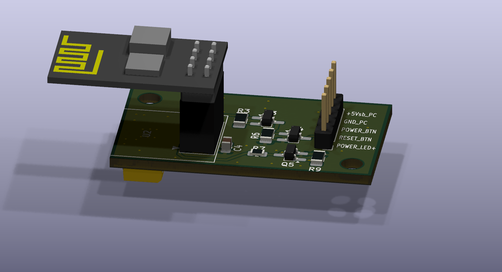
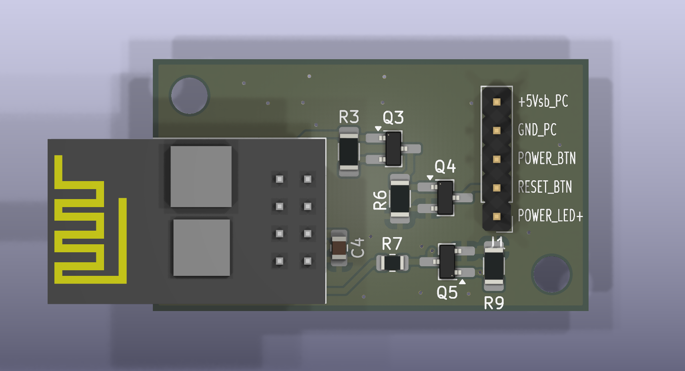
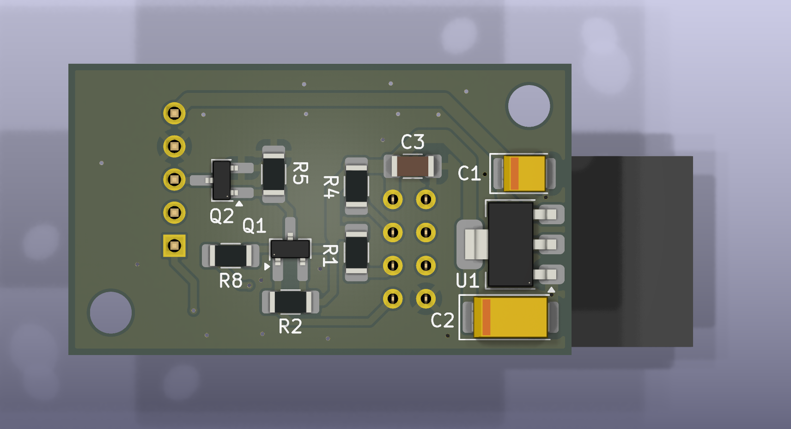

# ESPtoPC Wireless Remote Switch

Remote power-on / reset / force-shutdown for a desktop PC over WiFi, using an ESP-01 wired to the motherboard's front-panel header, plus an OpenWrt package (LuCI page + CLI) to manage one or more of these boards.

Built for the case where a PC needs to be turned on remotely even after a power outage — before the OS is up, before Wake-on-LAN is usable — by literally pressing the physical power button in software.

## Repo layout

```
├── esptopc_poweron_remote_pcb/
│   ├──esptopc_poweron_remote_pcb.kicad_pro   KiCad project
│   ├──esptopc_poweron_remote_pcb.kicad_pcb   Board layout
│   ├──esptopc_poweron_remote_pcb.kicad_sch   Schematic
│   ├──esptopc_poweron_remote_pcb.kicad_prl   KiCad local project settings
├── esptopc_poweron_remote/
│   ├──esptopc_poweron_remote.ino             ESP8266 (ESP-01) firmware
├── openwrt_program/
│   ├──deploy.sh                              One-shot installer for the OpenWrt
											  side: LuCI app + CLI tool + the
											  handshake listener
```

## How it fits together

```
[ESP-01 board]  --HTTP-->  [OpenWrt router]  <--LuCI/SSH--  [you]
   |    ^                     |
   |    |                     |-- LuCI page: device list, status, buttons
   |    `-- commands sent      -- CLI (`esptopcrsw`): menu + one-liners
   |        by OpenWrt         -- receives handshake/heartbeat from ESP
   `-- wired to PC's
       PWR_SW / RESET_SW
       header + reads the
       power-LED line
```

- The ESP-01 runs its own tiny HTTP server (power on / force off / reset / status) and also announces itself to the router (MAC + a fixed identifying string) so it shows up in LuCI ready to be named and saved.
- The OpenWrt side is the "brain": it tracks device state, decides which buttons make sense to show (e.g. no point offering "Reset" on a PC that's already off), and is what you actually interact with — LuCI in a browser, or `esptopcrsw` over SSH.

## Hardware (KiCad project)





Open `esptopc_poweron_remote_pcb.kicad_pro` in KiCad. The board:

- Regulates the PC's 5V standby rail down to 3.3V (AMS1117) to power the ESP-01;
- Uses two small MOSFET pairs (PMOS+NMOS per line) so the ESP's GPIO1 (TX) and GPIO3 (RX) can pull the motherboard's **PWR_SW** and **RESET_SW** header pins low, exactly like pressing the physical buttons;
- Reads the motherboard's power-LED line through a third MOSFET into GPIO2, to sense whether the PC is currently on (active-low: LOW = on);
- Leaves GPIO0 completely unused/unconnected on purpose, to avoid accidentally dropping into the bootloader

Connector `J1` (5-pin) goes to the motherboard: GND, +5V standby, PWR_SW, RESET_SW, and the power-LED line.

### List of required components for board assembly

| Reference | Qty | Value | Footprint | Datasheet |
| :--- | :--- | :--- | :--- | :--- |
| **C1** | 1 | 22uF | Capacitor_Tantalum_SMD:CP_EIA-3528-21_Kemet-B_HandSolder | |
| **C2** | 1 | 150uF | Capacitor_Tantalum_SMD:CP_EIA-6032-28_Kemet-C_HandSolder | |
| **C3** | 1 | 100nf | Capacitor_SMD:C_1206_3216Metric_Pad1.33x1.80mm_HandSolder | |
| **C4** | 1 | 1uf | Capacitor_SMD:C_0805_2012Metric_Pad1.18x1.45mm_HandSolder | |
| **J1** | 1 | Conn_01x05_Pin | Connector_PinHeader_2.54mm:PinHeader_1x05_P2.54mm_Vertical | |
| **Q1, Q3** | 2 | IRLML6402 | Package_TO_SOT_SMD:SOT-23_Handsoldering | |
| **Q2, Q4, Q5** | 3 | IRLML2502 | Package_TO_SOT_SMD:SOT-23_Handsoldering | |
| **R1, R4** | 2 | 10k | Resistor_SMD:R_1206_3216Metric_Pad1.30x1.75mm_HandSolder | |
| **R2, R3, R5, R6, R8, R9** | 6 | 10K | Resistor_SMD:R_1206_3216Metric_Pad1.30x1.75mm_HandSolder | |
| **R7** | 1 | 1K | Resistor_SMD:R_0805_2012Metric | |
| **U1** | 1 | AMS1117 | Package_TO_SOT_SMD:SOT-223-3_TabPin2 | [Datasheet](http://www.advanced-monolithic.com/pdf/ds1117.pdf) [1] |
| **U2** | 1 | ESP-01 | RF_Module:ESP-01 | [Datasheet](https://aithinker-static.oss-cn-shenzhen.aliyuncs.com/docs/_media_old/esp-01_product_specification_en.pdf) |

## Connection to PC

## Firmware (`esptopc_poweron_remote.ino`)

Flash with the Arduino IDE (ESP8266 core) via a USB-serial adapter. **TX/RX are used to drive the buttons**, so there's no Serial debug output. Flashing needs the special adapter, so you need to disconnect ESP-01 from the board first.

Before flashing, edit near the top of the file:

- `WIFI_SSID` / `WIFI_PASS` — your network;
- `DEVICE_PASSWORD` — shared identifying string, must match what you set in the OpenWrt app's settings (`/etc/config/esptopcrsw`); also used as the seed for the per-device command key (see **Security** below);
- `POWER_SHORT_MS = 300` - A short press of the Power button. The configured press duration setting should work in most cases;
- `POWER_LONG_MS  = 5000` - Long-press the Power button to force the system unit to shut down. The required duration of the press can vary significantly between different computers; if it does not work, you will need to experiment to find the right timing;
- `RESET_SHORT_MS = 300` - A short press of the Reset button. The configured press duration setting should work in most cases;
- `HANDSHAKE_INTERVAL_MS = 10000` - As long as the device is not connected to the router, it retries every 10 seconds;
- `HEARTBEAT_INTERVAL_MS = 90000` - Once the device connects to the router and is identified by the software, it sends a signal every 90 seconds to indicate it is still active. However, since the OpenWrt software does not store previous states — OpenWrt prorgam displaying only the status received while the program is actively running — updating the device's status may involve a brief wait (up to the duration mentioned). Consequently, you can reduce this interval to shorten the wait time. 

The board finds the router automatically (`WiFi.gatewayIP()`, no IP to hardcode) and keeps retrying forever, so boot order after a power outage doesn't matter.

HTTP endpoints the board exposes (all require `?key=...`, see below):

| Endpoint         | Effect                        |
|-------------------|-------------------------------|
| `GET /power/on`   | Short press of the power button |
| `GET /power/off`  | Long press (force shutdown)   |
| `GET /reset`      | Short press of the reset button |
| `GET /status`     | `{"pc_status":"on"\|"off"}`   |

All permission logic (e.g. "don't offer Reset while the PC is off") lives on the OpenWrt side, not in the firmware — the board just does what it's told and reports state.

## OpenWrt app (`deploy.sh`)

Self-contained installer — no package manager involved, just copies files to their real system paths and (re)starts the relevant services. Built against OpenWrt 25.x (APK-based, modern JSON-based LuCI menu/ACL — the classic Lua-controller style LuCI apps won't work the same way on this version).

### Install
In CMD in Windows I use this to copy `deploy.sh` to router:
```CMD
scp X:\way\to\your\deploy.sh root@<router-ip>:/root/
```
After this in SSH terminal connecting to routher install the app:
```sh
ssh root@<router-ip>
sh deploy.sh
```

Re-running `deploy.sh` after an update is safe — it won't wipe devices you've already added (`/etc/config/esptopcrsw` is only created if missing).

What it sets up:
- LuCI page under **Services → ESPtoPC Wireless Remote Switch**: device table with live status (On / Off / Offline), buttons that adapt to state, add-device picker (from the router's DHCP client list or typed by hand), and a banner for boards that announced themselves but aren't saved yet. **Initial setup and adding devices is carried out only in LuCI's ESPtoPC Wireless Remote Switch program page**;
- `esptopcrsw` CLI (see below);
- A second `uhttpd` instance on port 8090 that receives the handshake/heartbeat from ESP boards:
- `rpcd`/`ubus` backend (`/usr/libexec/rpcd/esptopcrsw`) that both the LuCI page and the CLI talk to;

### CLI

```sh
esptopcrsw                     # interactive menu, a convenient alternative to manual command entry
esptopcrsw list                # table of devices + status
esptopcrsw poweron <name>      # power on (or sleep, if already on)
esptopcrsw off <name>          # force power off
esptopcrsw reset <name>
esptopcrsw check <name>        # check/restore connection
esptopcrsw lang [en|ru|uk]     # interface language (remembered)
```

Any of `poweron` / `off` / `reset` asks for a one-letter confirmation first (`y/N`) naming the device and the action, so a stray keypress can't send a command to the wrong PC. If a device looks offline when you run a command, the CLI tries to reconnect first and reports what happened, instead of failing silently.

### Security

There's no login/password on the ESP's HTTP server itself — instead:

- **Handshake** (ESP → router): the board POSTs its MAC and a fixed identifying string to the router on boot/periodically, so the router knows it's genuinely this project's firmware announcing itself.
- **Commands** (router → ESP): every `/power/on`, `/power/off`, `/reset`, `/status` call requires `?key=<12-hex-chars>`, computed as `md5(MAC:DEVICE_PASSWORD)` truncated to 12 characters — the same formula on both sides, so no separate secret needs to be distributed or synced per board. This stops a stray browser tab pointed at the board's IP from doing anything, but it's **not encryption** — anyone actually sniffing the WiFi traffic can read the key and MAC in plain text. Good enough for "don't let someone on the LAN poke it by accident", not meant to survive a hostile network.

## Known rough edges

- The rpcd/JS/LuCI layer was written against documented conventions for modern OpenWrt (menu.d/acl.d JSON, JS views over ubus) but hasn't been exhaustively tested beyond this one setup — if something in LuCI breaks after an OpenWrt upgrade, that's the first place to look. 
- `busybox tr` on some builds doesn't support POSIX character classes (`[:lower:]`/`[:upper:]`) — the scripts here use explicit ranges (`a-z`/`A-Z`) everywhere for that reason; keep that in mind if you extend them.
- MAC addresses are stored/compared uppercase throughout, to avoid the same device getting registered twice under different casing.
